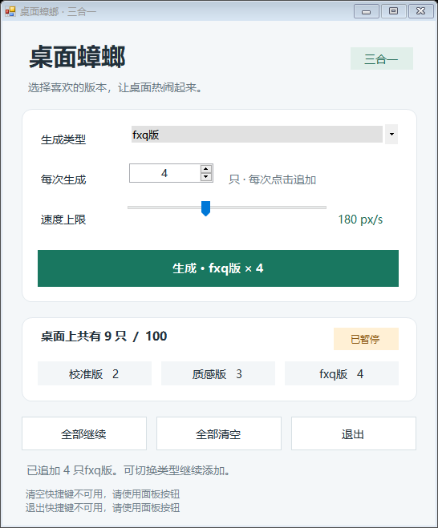
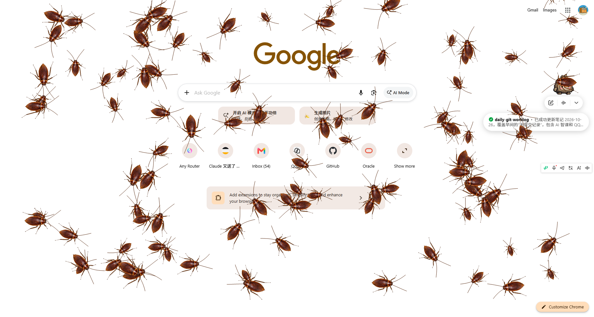
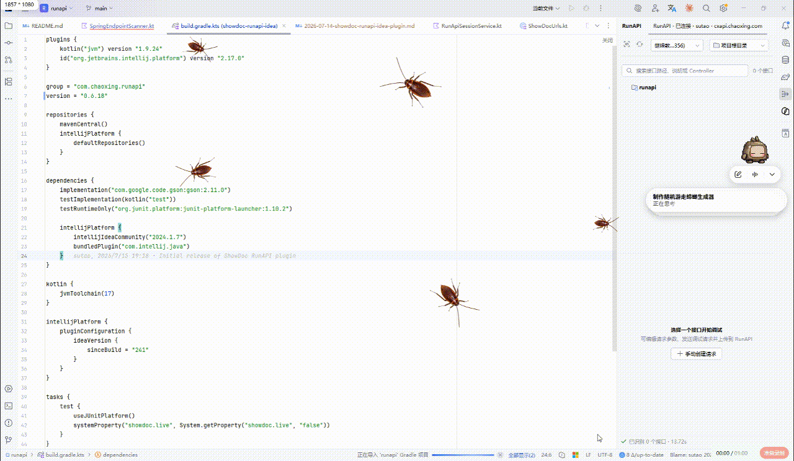

# 桌面蟑螂 · 三合一

Windows 便携桌面动画程序。一个控制面板可以分别生成 **校准版、质感版、fxq版**，三种类型可同时活动。



## 效果展示

桌面效果：



动态演示：



## 运行

下载根目录的 [桌面蟑螂-三合一.exe](桌面蟑螂-三合一.exe)，双击即可运行，无需安装。运行前先退出已打开的旧版。

- Windows 10 / 11，使用系统自带的 .NET Framework 4.x。
- 素材和三个原始版本内置于整合 EXE；日常运行不需要源码或旁边的其他 EXE。
- 选择类型、填写每次生成数量，然后点击生成；每次点击追加所选类型。
- 三种合计最多 100 只，统一调整速度、暂停/继续、清空及退出。
- 随机大小、停驻、行走和转向；活动范围为主屏幕可用桌面区域。
- 蟑螂透明窗口支持鼠标穿透；关闭控制面板会移除所有类型的覆盖窗口。
- Ctrl+Alt+C 清空，Ctrl+Alt+Q 退出；若快捷键被占用，面板会提示，可使用按钮。

## 保留的版本

| 文件 | 对应类型 |
| --- | --- |
| `桌面蟑螂-校准版.exe` | 校准版 |
| `桌面蟑螂-质感版.exe` | 质感版 |
| `桌面蟑螂-fxq版.exe` | fxq版 |
| `桌面蟑螂-三合一.exe` | 最新样式的整合控制面板 |

三个原始 EXE 同时是整合版的构建输入。整合版在内存中复用各自的模型、素材及透明窗口，不启动三个旧程序或旧控制面板。

## 构建与验证

在 Windows PowerShell 中执行：

```powershell
.uild-integrated.ps1
.uild-integrated.ps1 -Test
```

需要 Windows 自带的 .NET Framework C# 编译器，无需 Maven、Java、Python 或下载 NuGet 包。脚本会寻找 Framework64 或 Framework 下的 `csc.exe`。

构建产物名为 `桌面蟑螂-三合一新版.exe`，与仓库中已保留的 `桌面蟑螂-三合一.exe` 分开，避免覆盖运行中的程序。

测试会短暂显示控制面板和覆盖窗口，验证混合追加、统一暂停/恢复、暂停时生成、合计上限、窗口边界、不抢焦点、清空和关闭释放。现有测试报告位于 `tests/verification-integrated-ui.txt`。

## 目录

- `integrated/`：最新整合版控制面板与集成测试。
- `src/`：迭代过程中开发的动画模型、渲染器和单版本控制面板。
- `assets/`：生成的身体、腿部、人脸素材及对应提示词。
- `tests/`：测试源码、验证报告；不包含测试二进制和逐帧缓存。
- `docs/`：设计记录与参考资料说明。
- 根目录的 GIF 和说明文件：各阶段效果预览及历史使用说明。

`build.ps1` 用于构建当前单版本源码；`build.ps1 -NormalHead` 构建正常头小号版。历史说明中的版本名可能与后来重新命名的 EXE 不同，以本 README 的文件列表为准。

图片素材通过 imagegen 参考提供的照片制作，程序动画为二维关节模拟。仅供研究使用的第三方下载照片不随仓库上传。

## 社区交流

社区交流：[LinuxDo](https://linux.do)
